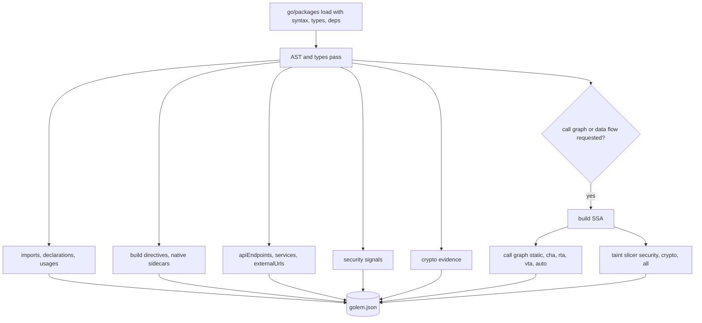

# golem: Go Library Evidence Mapper

golem is a static analyzer for Go source trees. It loads a module or workspace with the real Go toolchain, resolves types, builds SSA when asked, and writes a compact JSON report describing code structure, dependencies, call relationships, API endpoints, cryptographic use, and selected data flows.

The design goal is evidence collection, not exploit proof. Reports stay small and reviewable: symbols, source locations, package context, graph edges, classifications, and counts. Raw secrets, file contents, and command output are never copied into the report.

## Installation

golem ships as a binary named `golem-<platform-tuple>` in this repository's packages. cdxgen resolves it automatically for Go evinse scans; you can also point `GOLEM_CMD` at your own build:

```bash
cd thirdparty/golem
go build -o /usr/local/bin/golem ./cmd/golem
export GOLEM_CMD=/usr/local/bin/golem
```

Building golem requires Go 1.27 or later. The version that builds golem is also the newest language version it can type-check, since `go/types` applies the rules of its own release. A module declaring a newer `go` directive gets a `go-version` diagnostic in the report rather than a silent cascade of fake type errors.

## First report

```bash
golem analyze --dir /path/to/go/project --out golem.json
```

Useful variants:

```bash
golem analyze --dir . --callgraph static --format graphml --out callgraph.graphml
golem analyze --dir . --callgraph rta --dataflow security --out golem.json
golem analyze --dir . --tags prod,linux --tests --out golem.json
golem analyze --dir . --roots exported --out library.json
```

The default package pattern is `./...`. When `--dir` has no `go.mod` or `go.work`, golem discovers child modules and merges results; `--no-recurse` turns that off.

## What one analysis pass produces



The report schema is versioned and documented field by field in [JSON_ATTRIBUTE_REFERENCE.md](https://github.com/cdxgen/cdxgen-plugins-bin/blob/main/thirdparty/golem/JSON_ATTRIBUTE_REFERENCE.md) in `thirdparty/golem`.

## Call graphs

| Mode   | Implementation    | Practical behavior                                                             |
| ------ | ----------------- | ------------------------------------------------------------------------------ |
| none   | no graph          | fastest; source evidence only                                                  |
| static | static.CallGraph  | fast and deterministic; direct calls only                                      |
| cha    | cha.CallGraph     | conservative for interface dispatch; more edges                                |
| rta    | rta.Analyze       | roots-driven reachability; useful for executables                              |
| vta    | vta.CallGraph     | variable type analysis over the reachable set; often the most precise          |
| auto   | CHA to RTA to VTA | iterates down the chain on timeout; records which algorithm ran in diagnostics |

Two ideas matter when you read golem graphs.

Root selection decides what "reachable" means. `main` (the default) also seeds `init` and type-resolved framework registrations. `exported` is what makes a library analyzable: without it, a module with no `main` yields almost nothing because nothing is reachable. `handlers` seeds every detected HTTP handler, and `symbol:<regex>` seeds anything matching a pattern.

Filtering is a view, not an opinion. Stdlib and local-module exclusions are applied after reachability was computed on the complete graph. A path that runs through omitted code is preserved as one `collapsed` edge that records the hop count and the packages traversed, so a handler invoked through `net/http` still has an edge from the code that registered it. `--dependency-detail` controls the same idea for dependency interiors: `collapse` (default), `drop`, or `full` (`--include-all-flows` is an alias).

`callGraph.reachability` reports, per node, whether any root reaches it, the shortest distance, and which roots. `--reachable-symbols <file>` adds shortest witness paths for named symbols, capped by `--max-paths-per-symbol`.

## Data flow

```bash
golem analyze --dir . --dataflow security --dataflow-graph-out flows.graphml --out golem.json
```

Modes: `security` tracks input-to-execution and input-to-response style flows; `crypto` tracks key material into crypto APIs; `all` adds third-party module cache paths. Data flow uses the call graph when `--dataflow-callgraph` is not `none`, indexing dynamic callees by call site and replaying method summaries through them. Custom sources, sinks, passthroughs, and sanitizers merge with the built-in rules through `--dataflow-patterns <file>`, and `--dataflow-pattern-packs` selects among the built-in families (http, crypto, filesystem, process, and friends).

Every slice carries `reachableFromRoots`: true when any function the slice traverses is reachable from the entry roots, false for a flow that lives entirely in code the application never drives into. The verdict is computed on an RTA graph regardless of `--callgraph` — static and VTA miss interface, func-value and driver-registration dispatch, and CHA over-reaches into every implementation of a used interface — before any view is applied, and no slice is dropped to produce it. It is absent for libraries (no entry root beyond package initializers) and when no graph could be built; `dataFlow.sliceReachability` says which, along with the algorithm, root kinds and counts. "Reachable" is function-level, so a rooted slice is not proof that a caller passes tainted data.

### Forwarded headers

Request values a client can choose through the `Forwarded` and `X-Forwarded-*` headers are `proxy-derived` sources, with the kind (`client-ip`, `host`, `scheme`, or `forwarded-header` for a literal header read) in `taintKinds`: `r.RemoteAddr` and `r.Host` (rewritten by chi `middleware.RealIP` and gorilla `handlers.ProxyHeaders`), gin `ClientIP`, echo `RealIP` and `Scheme`, fiber `IP`, `IPs`, `Hostname` and `Protocol`, and `Header.Get` or gin `GetHeader` with a forwarded header's name as a literal. The socket view (`r.TLS`, gin `RemoteIP`) is not tagged. The `trusted-proxy-config` security signal marks the code that turns header handling on, with `framework` and `headers` (`forwarded`, `x-forwarded` or `all`) properties. Neither means a deployment is vulnerable: the values are spoofable only behind a proxy that passes the headers through, which a source scan cannot see. The full rule list is in `thirdparty/golem/JSON_ATTRIBUTE_REFERENCE.md`.

## API endpoints

Endpoint detection walks registration calls, so a Gin, chi, Echo, fiber, iris, or net/http service yields `apiEndpoints[]` records with framework, method, composed path, handler, package, and usage scope. Group prefixes are composed the way the frameworks compose them, including the group-root idiom `users.GET("", listUsers)`, which resolves to `/api/v1/users` instead of being dropped as pathless. Listeners such as `http.ListenAndServe` are recorded separately as `http-listener` records, and gRPC-style registrations as `rpc-service`.

On top of the route table, golem walks each handler body to recover signatures: path and query parameters from helpers like `c.Param("id")`, `chi.URLParam(r, "id")`, `r.PathValue("id")` and `r.URL.Query().Get("q")`; request body types from `c.ShouldBindJSON(&x)`, `render.DecodeJSON(r.Body, &x)`, or `json.NewDecoder(r.Body).Decode(&x)`; response types from `c.JSON(200, User{})`, `render.JSON(w, r, expr)`, or `json.NewEncoder(w).Encode(expr)`.

Three rules keep the output honest. Matching works on resolved package paths and parameter types, so `g "github.com/gin-gonic/gin"` aliases and a context parameter named `ctx` both work, and versioned module paths like `github.com/go-chi/chi/v5` match their unversioned spelling. Handlers can be named functions, method expressions, or inline func literals at the registration site. When a pattern cannot be matched with confidence, the field stays empty: a handler whose short name is declared twice in the package, on different receiver types, is left unenriched rather than enriched from the wrong body. A 4xx/5xx payload is stored as an error shape and only becomes `responseType` when the handler never emits a successful response.

`services[]` rolls endpoints up per framework, and `externalUrls[]` inventories literal URLs in source for egress review.

## Cryptographic evidence

The AST and types pass classifies crypto imports into families, resolves selector expressions like `crypto/md5.Sum` or `crypto/tls.LoadX509KeyPair` through type information, flags `InsecureSkipVerify: true` as a critical finding, and detects string literals bound to names that look like key material without copying the literal. The `crypto` section emits `libraries`, `assets`, `operations`, `materials`, `protocols`, and `findings`, with a `confidence` field separating type-resolved evidence from name-based indicators.

This is a finding aid for CBOM work. It is strong on direct use of known Go crypto APIs and weak primitives, and intentionally weak on custom wrappers, reflection-heavy code, and questions about key lifetime.

## cgo evidence

Golem loads packages with `CGO_ENABLED=0` unless the environment states a
choice, because compiling a cgo preamble would run the host C compiler with
flags the analysed packages choose through `#cgo` directives, `.syso` files and
pkg-config lines. Export `CGO_ENABLED=1` for the compiled view; golem warns on
stderr when that runs on a toolchain older than go1.26.11 or go1.27.4.

Either way, files that import "C" are read textually, and the report's `cgo`
object states the mode, the toolchain and its patch state, the names of any
`CGO_*_ALLOW` / `CGO_*FLAGS` variables in the load environment, and per-package
summaries with the owning module path, flag names and risk categories. A
`refused-by-go1.27.4` category means the patched toolchains refuse that input
outright; `path-escape` and `module-path` name where a path argument points;
`cgo-directive-in-source` marks `//go:cgo_*` directives in hand-written source;
`invalid-object` marks a `.syso` that is not an object or archive. Values,
paths and environment contents are never reported, only names and categories.
Note that `CGO_CFLAGS_ALLOW` and its siblings re-open refused flags for every
package in the build, and flags set in `CGO_CFLAGS` itself are never checked.

### The cgo pointer check

For every `C.f(...)` call, cgo decides per argument how much memory the
runtime pointer check may scan: `&x[i]`, `&x` and `x[i:j]` bound the check to
that element, field or slice, and any other argument that needs a check is
checked with no type information, which makes the runtime scan the entire heap
object behind the pointer and panic when any pointer field of that object
holds an unpinned Go pointer. Golem classifies every C call argument the way
`cmd/cgo/gcc.go` does and reports three findings.

`cgo-pointer-check-untyped` is the argument checked with no type information.
In the default mode the classification is textual: without the C prototype,
golem treats an argument as checked when it, or the assignment in the same
function that reaches it (the latest one before the call in an enclosing
block, so a name reused in two switch cases resolves per case), contains an
`unsafe.Pointer(...)` of a Go address the function itself takes (`&x`,
`&x[i]`, a slice, `unsafe.SliceData`), and the confidence says `textual`. An
`unsafe.Pointer` of a struct field, a parameter or a helper's result is left
to compiled mode, because libraries keep C handles in exactly those places.
With `CGO_ENABLED=1` the generated files carry the literal `_cgoCheckPointer`
calls cgo chose, and their `/*line*/` positions resolve back to the original
source, so the textual findings are confirmed, refuted or completed at the
same argument positions and the confidence says `high`. Type information from
the generated files adds severity: an object with pointer-shaped slots can
panic the scan (`panicRisk`, `pointerSlots` or `pointerArray`), and an object
whose every pointer field was pinned earlier in the function cannot
(`pinned`). Pinned means the pointers stored in the scanned memory:
`pin.Pin(s.other)` pins what `s.other` points to and satisfies the check,
while `pin.Pin(&s.other)` pins `s` itself, leaves the target of `s.other`
unpinned, and panics at run time, so golem does not count it. Arguments rooted in memory
a C call returned, or typed as a C type (including a Go name defined as a C
struct, such as `type Ctx C.struct_ctx`), are never findings, because
`cgoCheckPointer` returns as soon as it sees non-Go memory. An
`unsafe.Pointer` value whose origin the function does not show (a
parameter, a struct field, a helper's result) is reported at `low` severity
with `memoryOwner=unknown`: cgo does emit the untyped check, but the memory
may well be C's, which libraries commonly keep in such fields.

`cgo-unpinned-reachable` is an argument whose pointed-to type is recursive or
whose pointer chain exceeds the two levels cgo's check follows. Pinning the
first node does not silence a recursive type, because C can walk every node
after it; pinning inside a loop before the call does, since that is how code
pins a whole list. A finite chain deeper than two levels is always reported.
Depth counts from the memory C receives: for `&s.f` that is the field, not
the whole of `s`. It needs type information, so it
is emitted in compiled mode only; the pin analysis is intraprocedural and
path-insensitive, which the confidence states.

`cgocheck-disabled` names where the runtime pointer check itself is turned
off: a `GODEBUG` carrying `cgocheck=0` in the load environment, or the same
setting in a Dockerfile, Containerfile, Kubernetes YAML, Makefile, `.env`
file, shell script or an `os.Setenv` call, in a module that contains cgo. The
check is a start-up setting that `//go:debug` cannot set, so a configuration
file is the only in-repo place it can change; an `os.Setenv` after start-up
records intent, not effect, and the signal says so. `cgocheck2-enabled`
reports `GOEXPERIMENT=cgocheck2` as informational.

Every C call the analysis walked also produces a per-call-site record on
`cgo.callSites[]`: the position, the C symbol, and per argument the shape
(`addr`, `index`, `slice`, `untyped`, `unchecked`), the memory owner (`go`,
`c`, `unknown`) and whether the Go pointers in the memory the check covers
were pinned. The corpus and fixture suites run
the whole analysis in both cgo modes; the `golem:want signal` annotation
grammar carries `cgo=textual` / `cgo=compiled` guards for the expectations
that differ by mode.

## Output formats

`json` is the full report. `graphml` and `gexf` export the call graph and require a call graph mode. Data-flow sidecars are written with `--dataflow-graph-out` in graphml or gexf.

## What golem will not tell you

It will not prove an exploit, verify a TLS configuration end to end, validate a protocol state machine, or analyze a module whose `go` directive exceeds its build toolchain. Those limits are stated in the README and in the report diagnostics where possible.
